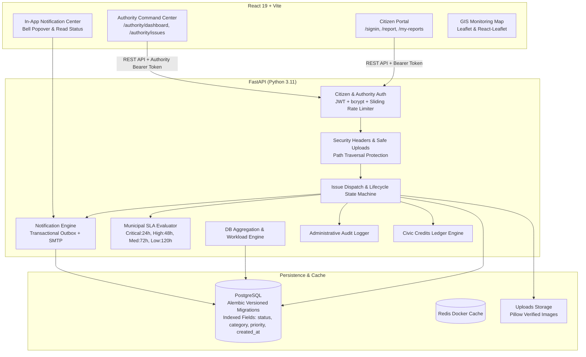

# CIVICSOL — AI-Based Civic Issue Detection and Reporting Platform

CIVICSOL is an enterprise-grade municipal civic issue management platform combining a citizen engagement portal with a municipal **Authority Command Center**. The system enables citizens to report local civic infrastructure defects with geolocation and image verification, track chronological resolution status, and earn Civic Credits, while providing municipal administrators, department officers, and field personnel with dispatch, lifecycle management, GIS spatial monitoring, audit trails, and automated municipal SLA compliance.

---

## 1. System Architecture



---

## 2. Platform Capabilities

### A. Citizen Portal & Engagement
* **Account Security**: Registration, JWT-based sign-in with sliding-window brute-force rate limiting (HTTP 429), and password recovery via OTP.
* **Incident Reporting**: Multi-part submission supporting title, category, description, and GPS coordinates.
* **Image Validation**: Server-side Pillow validation enforcing MIME types, maximum size limits (10 MB), and image header verification.
* **Civic Credits Ledger**: Citizens receive ledger transactions upon reporting and earn an additional `+20` credits upon verified authority resolution.
* **Chronological Status Timeline**: Citizens can view the complete lifecycle progression of their own reports including assignment dates, status history, official resolution notes, and verified evidence images.
* **Authorized Reopen Workflow**: Citizens can request reopening for reports marked `Resolved` or `Rejected` with a required non-empty explanation. Reopening shifts the issue status to `Reopened`, logs an audit entry, updates history, and notifies assigned officers.
* **In-App Notification Center**: Instant in-app alerts whenever reports are assigned, updated, resolved, rejected, or reopened with read/unread tracking and badge indicators.

### B. Authority Command Center
* **Role-Based Access Control (RBAC)**:
  * `SUPER_ADMIN`: Full municipal oversight, cross-department issue re-assignment, officer provisioning, department management, CSV exports, and full audit trail access.
  * `DEPARTMENT_OFFICER`: Departmental issue review, assignment of field officers within their department, report rejection with required reasoning, and resolution review.
  * `FIELD_OFFICER`: View assigned issues, update work status, submit work notes, and upload resolution image proof. Citizen personal contact info is redacted to prevent privacy leakage.
  * `CITIZEN`: Restricted to public citizen workflows; strictly rejected from authority endpoints with HTTP 403.
* **Municipal Service Level Agreement (SLA) Engine**:
  * Formalized municipal resolution timelines based on priority/severity:
    * **Critical**: 24 Hours
    * **High**: 48 Hours
    * **Medium**: 72 Hours
    * **Low**: 120 Hours
  * Active overdue computation across dashboards and queues with visual alert badges.
* **Issue Lifecycle State Machine**: Enforces valid status transitions:
  * `Reported` &rarr; `Under Review` &rarr; `Assigned` &rarr; `In Progress` &rarr; `Resolved` / `Rejected` / `Reopened`.
  * Arbitrary jumps (e.g. `Reported` &rarr; `Resolved`) are rejected with HTTP 400.
  * Every transition generates an immutable `IssueStatusHistory` entry.
* **Live GIS Issue Monitoring**: Interactive Leaflet map displaying geocoded incidents with color-coded status markers, category filters, and direct navigation to issue dossiers.
* **Database-Backed Analytics & Workloads**:
  * Real-time KPI metrics (urgent issues, unresolved backlog, SLA overdue count, resolution rate).
  * Departmental and officer comparative workload distributions (active open vs. resolved).
  * Streaming sanitized CSV export for municipal auditing and reporting.
  * Live administrative activity feed displaying recent audit events.

---

## 3. Technology Stack

* **Frontend**: React 19, Vite 8, React Router v7, React-Leaflet, Leaflet, Lucide React, Axios.
* **Backend**: FastAPI, Python 3.11, SQLAlchemy 2.0 ORM, Pydantic v2.
* **Database & Migrations**: PostgreSQL 16, Alembic 1.20 versioned schema migrations.
* **Security & Auth**: JWT (HS256) via `python-jose`, password hashing via `passlib[bcrypt]`.
* **Image Processing**: Pillow (PIL) binary header validation.
* **Testing**: Python `unittest`, FastAPI `TestClient`, SQLite in-memory `StaticPool` for isolated test runs.

---

## 4. Security Hardening

1. **Brute-Force & Rate Limiting**:
   * Sliding window thread-safe rate limiter applied to `/auth/signin` and `/authority/auth/login`.
   * Triggers `HTTP 429 Too Many Requests` with a `Retry-After: 60` response header upon 5 failed attempts within 60 seconds.
2. **Path Traversal Protection**:
   * Safe upload serving via `/uploads/{file_path:path}`.
   * Explicitly blocks directory traversal attempts (`..`, leading slashes, path normalization outside `uploads/` directory) and returns HTTP 400/404.
3. **Security Headers Middleware**:
   * Automatically injected on all HTTP responses:
     * `X-Content-Type-Options: nosniff`
     * `X-Frame-Options: DENY`
     * `X-XSS-Protection: 1; mode=block`
     * `Referrer-Policy: strict-origin-when-cross-origin`
     * `Content-Security-Policy: default-src 'self'; img-src 'self' data: blob:; script-src 'self' 'unsafe-inline'; style-src 'self' 'unsafe-inline';`
4. **CORS Restrictions**:
   * Restricted to explicitly configured origins defined in `CORS_ORIGINS` (defaulting to authorized local/production origins). Wildcards (`*`) are disallowed when credentials are exchanged.
5. **Data Privacy & Contact Redaction**:
   * Citizen phone numbers and personal IDs are concealed from field officers who do not require citizen personal contact information.
   * Public endpoints (map, analytics) never expose reporting citizen identities.
6. **Fail-Safe Notification Delivery**:
   * In-app notifications are stored atomically in a transactional outbox table before attempting external SMTP delivery.
   * Network errors or SMTP timeouts are caught and logged without aborting or rolling back committed issue status transitions.

---

## 5. Local Setup and Installation

### Prerequisites
* macOS / Linux / Windows WSL2
* Python 3.11 (Conda or virtual environment)
* Node.js 18+ and npm
* Docker & Docker Compose (for PostgreSQL and Redis)

### 1. Set Up Python Environment
```bash
cd ~/Documents/CIVICSOL
conda activate civicsol-dev
# Or using venv:
# python3 -m venv .venv && source .venv/bin/activate
pip install -r requirements.txt
```

### 2. Configure Environment Variables
Copy `.env.example` to `.env`:
```bash
cp .env.example .env
```
Fill in the parameters (PostgreSQL credentials, Redis host, and generate a secure 32+ character JWT secret).

### 3. Start Database and Redis via Docker
```bash
docker-compose up -d
```

### 4. Install Frontend Dependencies & Build
```bash
cd frontend
npm install
npm run build
cd ..
```

---

## 6. Database Initialization & Authority Setup

> **Note on Migration Boundary**: In accordance with project safety standards, migrations and bootstrap commands must be executed against development or production databases only after explicit architectural approval.

### Step 1: Run Database Migration
Apply the Alembic migrations to extend users, add departments, issue foreign keys, status history, notifications table, and performance indexes:
```bash
/opt/anaconda3/envs/civicsol-dev/bin/alembic upgrade head
```

### Step 2: Seed Default Municipal Departments
Seed the 6 standard departments (idempotent; safe to run multiple times):
```bash
/opt/anaconda3/envs/civicsol-dev/bin/python backend/scripts/seed_departments.py
```
Standard seeded departments:
1. `ROADS_BRIDGES`: Roads & Bridges
2. `SOLID_WASTE`: Solid Waste Management
3. `STREET_LIGHTING`: Street Lighting
4. `WATER_SEWERAGE`: Water Supply & Sewerage
5. `DRAINAGE`: Drainage
6. `PUBLIC_INFRA`: Public Infrastructure

### Step 3: Bootstrap Initial Super Admin Account
Run the interactive one-time bootstrap utility:
```bash
/opt/anaconda3/envs/civicsol-dev/bin/python backend/scripts/bootstrap_super_admin.py
```
The script will prompt interactively for:
* Full Name (e.g., `Municipal Chief Administrator`)
* Official Email (e.g., `admin@civicsol.gov`)
* Employee ID (e.g., `SA-00001`)
* Password (masked prompt; enforces minimum 8 characters, uppercase, lowercase, digit, and special character).

---

## 7. Reliability, Health Checks & Operations

### A. Active Health Check
The backend provides an active diagnostic endpoint at `GET /health`:
* Verifies live database connectivity via active query (`SELECT 1`).
* Verifies read and write access to the local uploads directory.
* Returns `HTTP 200 OK` with JSON diagnostics when healthy:
  ```json
  {
    "status": "healthy",
    "timestamp": "2026-10-29T21:50:00Z",
    "database": "connected",
    "storage": "writable"
  }
  ```
* Returns `HTTP 503 Service Unavailable` if database or storage is unreachable.

### B. Database Backup & Disaster Recovery Procedure

#### 1. Automated PostgreSQL Backup
Create a compressed binary dump of the PostgreSQL database:
```bash
docker exec -t civicsol_postgres pg_dump -U civicsol_user -d civicsol -F c -b -v -f /tmp/civicsol_backup_$(date +%Y%m%d_%H%M%S).dump
docker cp civicsol_postgres:/tmp/civicsol_backup_$(date +%Y%m%d_%H%M%S).dump ./backups/
```

#### 2. Isolated Test Restoration
To verify backup integrity in an isolated container without risking development or production data:
```bash
# 1. Start a temporary test database container
docker run --name civicsol_restore_test -e POSTGRES_USER=test_user -e POSTGRES_PASSWORD=test_pass -e POSTGRES_DB=test_db -p 5433:5432 -d postgres:16-alpine

# 2. Restore the dump into the test container
docker cp ./backups/civicsol_backup_*.dump civicsol_restore_test:/tmp/restore.dump
docker exec -t civicsol_restore_test pg_restore -U test_user -d test_db -v /tmp/restore.dump

# 3. Verify record counts and table schemas
docker exec -it civicsol_restore_test psql -U test_user -d test_db -c "SELECT count(*) FROM users; SELECT count(*) FROM civic_issues;"

# 4. Clean up test container
docker rm -f civicsol_restore_test
```

---

## 8. Automated Test Suite

All tests execute against an isolated in-memory SQLite database (`StaticPool`), ensuring zero data contamination of development PostgreSQL databases:

```bash
/opt/anaconda3/envs/civicsol-dev/bin/python -m unittest discover tests -v
```

### Test Coverage Summary (55 Passing Automated Tests):
* **`tests/test_auth.py` (14 tests)**:
  * Citizen signup, signin, token generation, missing auth header handling, centralized JWT validation, password change validation, OTP token compatibility.
* **`tests/test_issues.py` (8 tests)**:
  * Valid report submission, MIME type rejection, corrupted image binary rejection, oversized file rejection (>10 MB), latitude/longitude boundary validations, citizen data isolation.
* **`tests/test_migration.py` (5 tests)**:
  * Legacy schema preservation, default `CITIZEN` role assignment, nullable foreign key compatibility, department seeding idempotency, Super Admin bootstrap refusal on duplicate admin.
* **`tests/test_authority.py` (16 tests)**:
  * Authority login, citizen rejection (HTTP 403), inactive officer rejection, public signup role elevation prevention, RBAC boundary enforcement (Field Officer vs. Super Admin), complete issue lifecycle (assignment &rarr; in-progress &rarr; resolved), Pillow evidence validation, +20 credit award idempotency, status transition state machine, officer and department provisioning, final Super Admin deactivation protection, database-backed statistics, GIS map endpoint, Super Admin audit log scoping.
* **`tests/test_extensions.py` (12 tests)**:
  * In-app notification creation & user isolation, notification read-all and unread counts, citizen timeline access and Bob/Alice 403 boundary, citizen reopen workflow & state restrictions, login rate limiting (HTTP 429), security headers middleware, path traversal rejection, active `/health` check, authorized streaming CSV export, recent administrative activity feed, officer workload comparative metrics, and municipal SLA overdue evaluation.

---

## 9. Production Readiness Checklist

Before promoting CIVICSOL to production:

- [x] **Frontend Production Bundle**: Verified via `npm run build` (0 bundling or syntax errors).
- [x] **Backend Test Verification**: 55/55 automated tests passing cleanly.
- [x] **Database Schema Migrations**: Safe versioned Alembic migrations (`20261029_001` and `20261029_002`) prepared.
- [ ] **HTTPS Enforcement**: In production, terminate TLS via reverse proxy (Nginx / Caddy / Cloudflare) and enforce `Strict-Transport-Security`.
- [ ] **Secret Hygiene**: Ensure all production JWT secrets, database credentials, and SMTP passwords are set via protected cloud secret stores (e.g. AWS Secrets Manager or HashiCorp Vault), never stored in `.env` or code.
- [ ] **Cloud Storage Migration**: Transition local uploads from disk storage (`uploads/`) to S3/GCS with signed private URLs.
- [ ] **Production Database Application**: Run `alembic upgrade head` and department seed on the production PostgreSQL instance only after final authorization.
