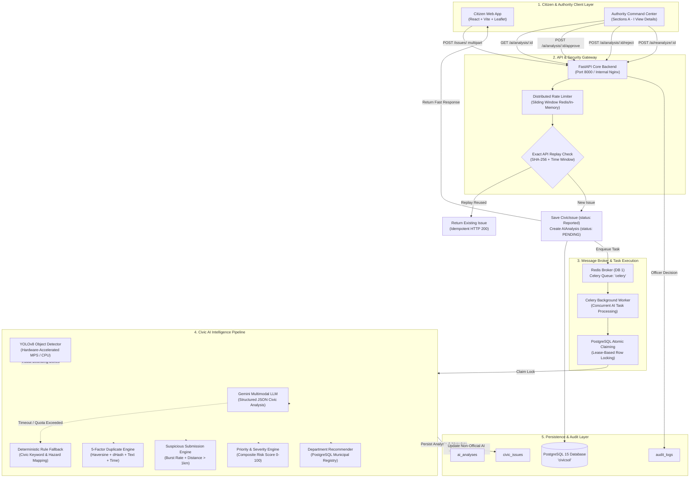
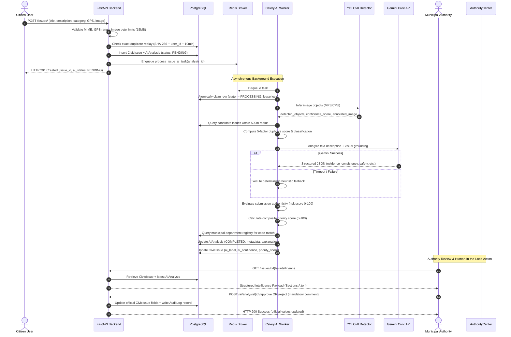

# CIVICSOL V1.0 — Final AI Architecture & Systems Integration Specification

**System Version:** CIVICSOL 1.0 (Production Release Candidate)  
**Date:** October 31, 2026  
**Security Level:** Municipal Confidential / Staging Hardened  
**Primary Modules:** `backend/ai/`, `backend/routes/issues.py`, `backend/authority/`, `ml/yolo_detector.py`  

---

## 1. System Overview & Core Philosophy

CIVICSOL is an enterprise municipal civic issue reporting, computer vision detection, and intelligence dispatch system. Its architectural foundation rests upon three non-negotiable principles:

1. **Asynchronous Non-Blocking Citizen Experience:**  
   Citizen issue submissions return immediately with HTTP 201 Created and an initial `PENDING` AI processing status. Heavy deep learning inference and multimodal LLM analysis run strictly asynchronously in isolated background worker processes via Celery and Redis.
2. **Advisory AI with Mandatory Human-in-the-Loop Governance:**  
   AI models (YOLOv8, Google Gemini, duplicate detection, and fraud scoring) are **strictly advisory decision-support tools**. AI never alters official issue status, never auto-rejects citizen submissions, and never overrides citizen-reported categories without officer review. Every official dispatch, reclassification, and status transition requires an authenticated officer action with an immutable audit log.
3. **Resilience & Graceful Degradation:**  
   The platform operates seamlessly even during full cloud outages or missing weights. If the Gemini API is unreachable, deterministic municipal heuristic rule engines take over instantly. If Redis is unavailable, rate limiters degrade to thread-safe in-memory windows. If YOLO weights are absent, processing status marks `MODEL_UNAVAILABLE` while citizen evidence is preserved intact.

---

## 2. End-to-End System Architecture Diagram

---

## 3. Data Flow & Execution Sequence

---

## 4. Detailed Component Specifications

### 4.1 YOLOv8 Object Detection Interface (`ml/yolo_detector.py`)
- **Model:** Ultralytics YOLOv8 Architecture  
- **Classes:** 8 municipal hazard classes (`pothole`, `garbage`, `street_light`, `water_leakage`, `damaged_infrastructure`, `fallen_tree`, `traffic_hazard`, `flooding`)  
- **Hardware Acceleration:** Auto-detected Apple Silicon MPS (Metal Performance Shaders) with automatic CPU fallback.  
- **Thresholding Strategy:**
  - Standard confidence threshold: $0.25$
  - Low-confidence advisory threshold: $0.15 \le \text{conf} < 0.25$ (marked with warning)
  - Severe low-confidence filter: $< 0.15$ (suppressed to prevent background noise)
- **Supported Detection States:**
  - `DETECTIONS_FOUND`: Objects detected above threshold.
  - `NO_DETECTION`: Clean scene, no objects above threshold.
  - `LOW_CONFIDENCE`: Detections found between $0.15$ and $0.25$.
  - `MODEL_UNAVAILABLE`: Weights file missing or invalid.
  - `INVALID_IMAGE`: Corrupted bytes or unsupported MIME type.
  - `PROCESSING_FAILED`: Unhandled internal exception.

### 4.2 Gemini Multimodal Civic Intelligence (`backend/ai/gemini_service.py`)
- **Models:** Primary `gemini-3.5-flash`, secondary fallback `gemini-3.5-flash-lite`.
- **Structured JSON Schema Contract (Phase 7 Compliant):**
  - `citizen_reported_category`: Category selected by citizen.
  - `yolo_detected_categories`: List of classes identified by computer vision.
  - `category_confidence`: Top detection confidence score (0.00 to 1.00).
  - `evidence_consistency`: `CONSISTENT` | `INCONSISTENT` | `UNCERTAIN`.
  - `requires_human_review`: Boolean (`true` if visual and textual claims disagree).
  - `disagreement_explanation`: Detailed officer justification explaining evidence mismatch.
  - `safety_concerns`: Specific public safety hazards (motorists, pedestrians, electrocution).
  - `severity`: Suggested severity level (`CRITICAL`, `HIGH`, `MEDIUM`, `LOW`).
  - `priority`: Suggested priority level (`URGENT`, `HIGH`, `NORMAL`, `LOW`).
  - `recommended_department`: Mapped municipal department code.
  - `risk_level`: Evaluated authenticity risk (`NORMAL`, `LOW_RISK`, `REVIEW_REQUIRED`, `HIGH_RISK`).
  - `duplicate_assessment`: Nearest proximity duplicate tier.

### 4.3 Five-Factor Duplicate Detection Engine (`backend/ai/duplicate_detector.py`)
- **Proximity Window:** 500 meters radius (`R_max = 500m`).
- **Composite Score Formula:**
  $$\text{Score} = 0.25 S_{\text{geo}} + 0.30 S_{\text{img}} + 0.20 S_{\text{cat}} + 0.15 S_{\text{desc}} + 0.10 S_{\text{time}}$$
- **Visual Checksums:** 64-bit Difference Hash (dHash) normalized above chance ($0.65$) + cryptographic SHA-256 exact match.
- **Tiers:** `EXACT_REPLAY` (100%), `HIGH_CONFIDENCE_DUPLICATE` ($\ge 70\%$), `POSSIBLE_DUPLICATE` ($\ge 40\%$), `UNIQUE_REPORT` ($< 40\%$).

### 4.4 Suspicious Submission Risk Engine (`backend/ai/suspicious_detector.py`)
- **Dimension 1:** Reused photograph at distant coordinates ($> 1\text{ km}$ away) $\to +45$ pts.
- **Dimension 2:** Submission burst frequency ($> 3$ reports in 5 minutes) $\to +30$ pts.
- **Dimension 3:** Contradictory evidence (text contradicts photo) $\to +20$ pts.
- **Dimension 4:** Corrupted/anomalous file ($< 3\text{ KB}$ or $< 100\times 100\text{ px}$) $\to +15$ pts.
- **Tiers:** `NORMAL` ($0-14$), `LOW_RISK` ($15-34$), `REVIEW_REQUIRED` ($35-59$), `HIGH_RISK` ($\ge 60$).

### 4.5 Authority Command Center View Details UI (`frontend/src/pages/authority/IssueDetails.jsx`)
Structured into 9 standardized sections:
- **Section A: Citizen Evidence:** Title, description, GPS coordinates, citizen photo vs resolution evidence photo.
- **Section B: YOLO Detection:** Status pill, model version, confidence %, detected bounding box chips, low-confidence alert, annotated image overlay, Flag False Positive modal.
- **Section C: Gemini Intelligence:** Extracted problem, safety concerns list, evidence consistency badge, human review warning banner, explainable reasoning breakdown.
- **Section D: Duplicate Detection:** Classification badge, nearby matching reports table with GPS distance, image match %, text match %, category match, and Link / Merge actions.
- **Section E: Suspicious Submission Assessment:** Anomaly risk score meter, risk factor bullet points, advisory municipal notice.
- **Section F: Severity & Priority Recommendation:** Composite risk score meter (0-100), 5-factor breakdown tiles (Base hazard, safety evidence, location sensitivity, report volume, age factor).
- **Section G: Department Recommendation & Dispatch:** AI suggested department vs official department, department and field officer assignment dropdown selectors, update button.
- **Section H: AI Processing & Review Controls:** Current review status, reviewer note, approval impact delta table, officer notes input, Approve, Reject, Reanalyse Image, Run Pipeline, and AI History modal.
- **Section I: Authority Decision & Status Audit History:** Status lifecycle transitions (Under Review, In Progress, Complete & Upload Evidence, Reopen, Reject), chronological audit trail timeline.

---

## 5. Security & Governance Invariants

1. **Host Isolation:** PostgreSQL (5432) and Redis (6379) bound strictly to `127.0.0.1` or internal Docker networking. Never publicly accessible.
2. **Role Restrictions:**
   - AI Maintenance recovery (`POST /ai/maintenance/recover`): Restricted strictly to `SUPER_ADMIN`.
   - Issue Merge (`POST /ai/analysis/{id}/link_duplicate` with action `MERGE`): Restricted to `DEPARTMENT_OFFICER` and `SUPER_ADMIN`.
   - Issue Approval (`POST /ai/analysis/{id}/approve`): Restricted to `DEPARTMENT_OFFICER` and `SUPER_ADMIN`.
   - False Positive Flagging (`POST /ai/analysis/{id}/false_positive`): Restricted to authenticated municipal officers.
3. **Audit Trail Integrity:** Every approval, rejection, duplicate merge, false positive flag, and status transition writes an immutable row to `audit_logs` capturing officer ID, client IP address, timestamp, and justification.
