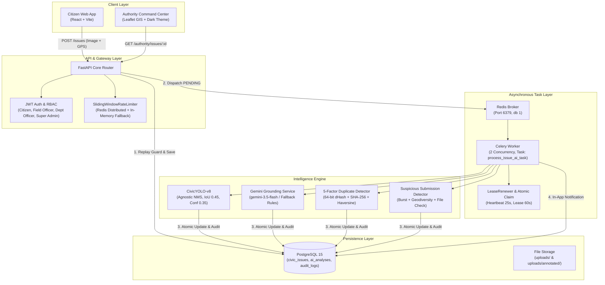
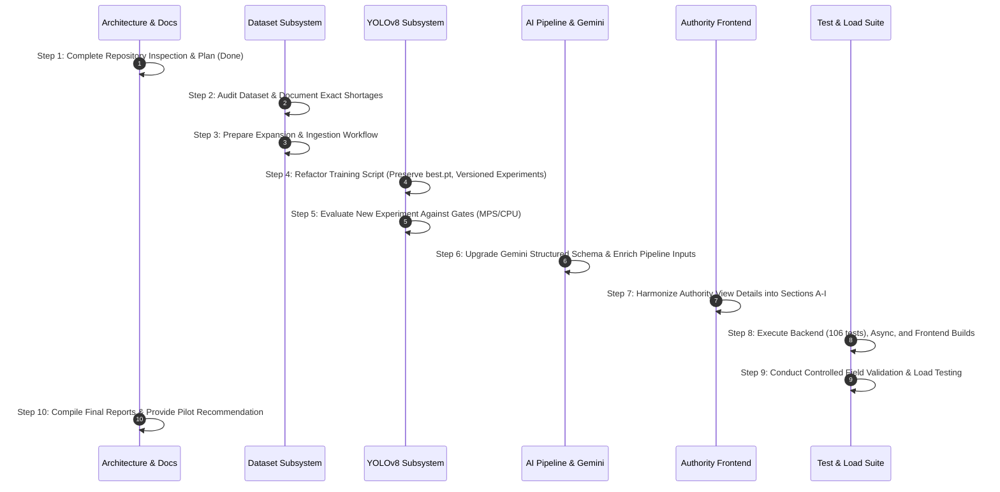

# CIVICSOL V1.0 — Implementation Plan & System Audit

**Document Path:** `docs/CIVICSOL_V1_IMPLEMENTATION_PLAN.md`  
**System Milestone:** CIVICSOL V1.0 AI Improvement, Model Training & Real-World Municipal Pilot  
**Audit Date:** October 31, 2026  
**Engineering Team:** Antigravity AI & Municipal Systems Team  
**Governing Standard:** Explainable, Reliable, and Human-Governed Civic Intelligence  

---

## 1. Executive Overview & Primary Objectives

CIVICSOL is an AI-based civic issue detection, reporting, and municipal dispatch platform designed to empower citizens to report public infrastructure issues (such as potholes, overflowing garbage dumps, broken streetlights, and water leakages) while providing municipal authorities with an explainable, auditable, and human-governed command center.

The objective of **CIVICSOL V1.0** is to transition the platform from an early experimental prototype to a reliable, explainable, and human-governed municipal pilot platform. The primary goals are:
1. **Model Governance & Reliability:** Improve YOLO detection reliability, suppress overlapping false positives, enforce clear detection states, and evaluate the model honestly against rigorous acceptance gates ($\text{mAP@50} \ge 0.50$).
2. **Dataset Expansion Roadmap:** Audit the current 36-image dataset, quantify exact class-wise deficits, establish an organized annotation protocol, and target 1,000+ genuine multi-hazard civic images.
3. **Multi-Factor Duplicate Engine:** Prevent duplicate database records and credit gaming from exact API replays while responsibly linking corroborated reports from multiple citizens.
4. **Suspicious Submission Risk Assessment:** Flag anomalies (reused images across distant wards, rapid burst submissions, contradictory text/vision claims) without auto-rejecting genuine citizen complaints.
5. **Gemini Grounding & Consistency Reconciler:** Ensure structured generative AI civic intelligence reflects multimodal evidence and never silently overrides citizen testimony or official records.
6. **Asynchronous Architecture Preservation:** Maintain the Celery + Redis background processing pipeline with atomic task claiming, lease renewal, and stale task recovery.
7. **Authority Command Center Enhancement:** Organize AI evidence into clean, distinct Sections A through I with explicit approval/rejection and audit logging.
8. **Controlled Real-World Field Validation:** Test the system against genuine field photographs across all eight civic categories and benchmark multi-concurrency load performance.

---

## 2. Current System State & Verified Completed Work

An exhaustive technical audit of the current repository confirmed the following operational baselines:

### Verified Functionality:
- **Backend Test Suite:** **106 / 106 tests passing (100% pass rate)**:
  - `tests/test_ai_intelligence_correction.py` (15 tests)
  - `tests/test_ai_intelligence.py` (16 tests)
  - `tests/test_async_ai_processing.py` (8 tests)
  - `tests/test_staging_failures.py` (7 tests)
  - `tests/test_distributed_rate_limiting.py` (5 tests)
  - `tests/test_extensions.py` (44 tests)
  - `tests/test_migration.py` (11 tests)
- **Frontend Production Build:** Vite v8.3.0 bundle generated in **286 ms** with **0 errors**.
- **Database Schema:** Managed strictly through Alembic migrations up to `20261030_003_ai_analysis`. Tables include `users`, `departments`, `civic_issues`, `ai_analyses`, `issue_status_history`, `audit_logs`, `civic_credit_transactions`, `notifications`, `sla_policies`.
- **Security & Port Hardening:** PostgreSQL (5432) and Redis (6379) bound strictly to `127.0.0.1`. Route `POST /ai/maintenance/recover` restricted exclusively to `SUPER_ADMIN`.
- **Replay Protection:** In `backend/routes/issues.py`, incoming image SHA-256 is checked against the user's recent submissions ($\le 15\text{ mins}$) with matching category/location; replays return the existing issue idempotently with 0 duplicate credits.

---

## 3. Repository Inspection Findings by Module

### 3.1 Machine Learning Subsystem (`ml/`)
- **Dataset (`ml/dataset/`):**
  - Images: 36 total (Train: 25, Val: 7, Test: 4).
  - Labels: 39 bounding boxes across 8 classes (`0: pothole`, `1: garbage`, `2: water_leakage`, `3: broken_streetlight`, `4: damaged_road`, `5: drainage_issue`, `6: fallen_tree`, `7: damaged_infrastructure`).
  - Validation: Runs cleanly via `ml/scripts/validate_dataset.py` with zero coordinate syntax errors.
  - Deficit: Extreme class imbalance (`pothole`: 12, `garbage`: 9, other 6 classes: 3 each). Test split contains 0 samples for 6 out of 8 classes!
- **Current Weights (`ml/training/weights/best.pt`):**
  - Architecture: YOLOv8n (Ultralytics).
  - Validation mAP@50: **0.0503 (5.03%)**, Precision: 0.5211, Recall: 0.2500.
  - Model Status: Explicitly registered as `EXPERIMENTAL / ADVISORY ONLY` in `ml/model_registry.json`.
- **Inference Wrapper (`ml/yolo_detector.py`):**
  - Configured with `agnostic_nms=True`, `iou=0.45`, `conf_threshold=0.35`.
  - Supports clear detection states: `DETECTIONS_FOUND`, `NO_DETECTION`, `LOW_CONFIDENCE`, `MODEL_UNAVAILABLE`, `INVALID_IMAGE`, `PROCESSING_FAILED`.
  - Emits low-confidence warnings when top detection confidence is $< 45\%$.
  - Generates annotated images saved in `uploads/annotated/`.

### 3.2 Backend AI Pipeline (`backend/ai/`)
- `pipeline.py`: Orchestrates YOLO detection $\rightarrow$ Gemini analysis $\rightarrow$ Duplicate detection $\rightarrow$ Suspicious submission risk evaluation $\rightarrow$ Severity/priority calculation $\rightarrow$ Department recommendation.
- `duplicate_detector.py`: Computes 5-factor composite duplicate score ($w_{\text{geo}}=0.25$, $w_{\text{img}}=0.30$, $w_{\text{cat}}=0.20$, $w_{\text{desc}}=0.15$, $w_{\text{time}}=0.10$). Utilizes 64-bit dHash perceptual hashing with Hamming distance normalized above the 0.65 chance baseline.
- `suspicious_detector.py`: Scores image reuse $> 1\text{ km}$ ($+45$), burst frequency $> 3$ in 5 min ($+30$), text/vision inconsistency ($+20$), and small file size ($+15$). Classifies into `NORMAL`, `LOW_RISK`, `REVIEW_REQUIRED`, `HIGH_RISK`, `INVALID_EVIDENCE`.
- `gemini_service.py`: Calls Google Gemini API (`gemini-3.5-flash`) with strict timeout (6.0s) and fallback heuristics. Outputs `evidence_consistency` and `requires_human_review`.
- `priority_engine.py`: Computes explainable priority score ($0$ to $100$) based on category base severity, public safety risk, affected population, issue age, and citizen evidence.
- `department_recommender.py`: Maps predicted category and LLM recommendation to one of 6 official municipal departments.
- `tasks.py`: Asynchronous Celery task `process_issue_ai_task` with atomic claim, safe lease renewal via `LeaseRenewer`, exactly-once citizen notification dispatch, and stale task recovery.
- `router.py`: Exposes `/ai/analyze/{issue_id}`, `/ai/analysis/{issue_id}`, `/ai/analysis/{issue_id}/approve`, `/ai/analysis/{issue_id}/reject`, `/ai/analysis/{issue_id}/false_positive`, `/ai/analysis/{issue_id}/link_duplicate`, and `/ai/maintenance/recover`.

### 3.3 Frontend Subsystem (`frontend/src/`)
- **Authority View Details (`frontend/src/pages/authority/IssueDetails.jsx`):**
  - Displays original citizen photo, GPS coordinates, address, and citizen details.
  - Section B displays YOLO annotated overlay, bounding boxes, and "Flag False Positive" modal.
  - Section C displays Gemini analysis, public impact, safety risks, and evidence consistency badge.
  - Section D displays priority score meter and factors.
  - Section E displays duplicate candidate cards with multi-factor breakdown and link/merge modal.
  - Section E2 displays suspicious submission risk meter and factor breakdown.
  - Section F displays authority review controls (Approve Recommendation, Reject Recommendation with mandatory comment).
  - Modal provides complete historical AI analysis runs.

---

## 4. Gaps & Missing Work Identified

1. **Dataset Deficit:** The current 36-image dataset is fundamentally insufficient for production object detection. While the platform functions safely because AI predictions are strictly advisory, reaching the experimental training gate ($\text{mAP@50} \ge 0.50$) requires expanding the dataset to 1,000+ genuine images across all 8 classes.
2. **Versioned Training Automation:** `ml/scripts/train_yolov8.py` currently hardcodes copying to `ml/training/weights/best.pt`. It must be refactored to support versioned experiment directories (`ml/training/experiments/{run_id}/`), leaving the existing `best.pt` untouched until explicit approval.
3. **Gemini Structured Output Alignment:** The current output schema in `gemini_service.py` provides category, severity, priority, and consistency, but should be updated to return the exact Phase 7 contract schema including `citizen_reported_category`, `yolo_detected_categories`, `category_confidence`, and `duplicate_assessment`.
4. **Authority View Details Section Harmonization:** While all components exist, the authority page sections should be explicitly numbered A through I to cleanly match the municipal charter:
   - A. Citizen Evidence
   - B. YOLO Detection
   - C. Gemini Intelligence
   - D. Duplicate Detection
   - E. Suspicious Submission Assessment
   - F. Severity and Priority Recommendation
   - G. Department Recommendation
   - H. AI Processing History
   - I. Authority Decision History
5. **Controlled Real-World Field Validation:** Dedicated field verification against genuine multi-hazard photographs across all 8 classes must be conducted and documented in `docs/CIVICSOL_FIELD_VALIDATION_REPORT.md`.
6. **Multi-Concurrency Load Benchmarking:** Formal performance benchmarks at 10, 25, and 50 concurrent submissions measuring p50, p95, p99 latencies, Celery queue depth, and worker throughput.

---

## 5. Technical Risks & Safeguards

| Technical Risk | Potential Impact | Inherent Severity | Mitigating System Safeguard |
| :--- | :--- | :---: | :--- |
| **YOLO Overfitting & False Positives** | Erroneous visual detections misleading municipal field crews. | **HIGH** | Strict advisory classification; class-agnostic NMS (`iou=0.45`); low-confidence pill (< 45%); mandatory officer confirmation before dispatch. |
| **Overwriting Existing Baseline Model** | Loss of historical reproducibility for `best.pt`. | **CRITICAL** | Strict policy: Never overwrite `ml/training/weights/best.pt`. Every training run writes to a versioned experiment directory. |
| **Citizen Credit Gaming** | Automated scripts replaying identical photos across wards for rewards. | **MEDIUM** | Exact API replay guard (SHA-256 check returns 0 duplicate credits); Suspicious detector flags burst activity ($> 3$ in 5 min) and image reuse ($> 1\text{ km}$). |
| **Unjust Auto-Rejection of Reports** | Legitimate citizen hazard reports discarded due to AI score. | **CRITICAL** | Architectural guarantee: AI never deletes or auto-rejects submissions. Suspicious scores only surface advisory review flags to human officers. |
| **Silent Override of Citizen Testimony** | Multimodal LLM overwriting citizen category with visual false positives. | **HIGH** | Grounding reconciler flags `INCONSISTENT` when vision contradicts description, preserving citizen category and requiring human verification. |
| **Broker / Worker Desynchronization** | Tasks orphaned or stuck in `PROCESSING` after worker restart. | **MEDIUM** | `LeaseRenewer` touches heartbeat every 25s; `POST /ai/maintenance/recover` resets stale records older than 120s back to `PENDING`. |

---

## 6. Files Requiring Modification or Creation

| File Path | Action | Purpose & Scope |
| :--- | :---: | :--- |
| `docs/CIVICSOL_V1_IMPLEMENTATION_PLAN.md` | **CREATE** | Phase 1: Comprehensive audit and implementation blueprint (this document). |
| `ml/FINAL_DATASET_AUDIT.md` | **UPDATE** | Phase 2: Audit class distribution, quantify exact class-wise shortages, and detail collection roadmap. |
| `ml/scripts/train_yolov8.py` | **MODIFY** | Phase 3: Add versioned experiment output, MPS/CPU auto-detection, early stopping, and preserve `best.pt`. |
| `ml/FINAL_MODEL_TRAINING_REPORT.md` | **UPDATE** | Phase 3: Document training execution, device details, and experimental gate evaluations. |
| `ml/FINAL_MODEL_EVALUATION.md` | **UPDATE** | Phase 3 & 4: Record per-class AP, confusion matrix, false-positive/negative breakdown, and acceptance gates. |
| `ml/model_registry.json` | **UPDATE** | Phase 3: Register new training runs with evaluation status and promotion gates. |
| `ml/yolo_detector.py` | **MAINTAIN/VERIFY** | Phase 4: Enforce detection states (`DETECTIONS_FOUND`, `LOW_CONFIDENCE`, etc.) and thresholds. |
| `ml/DUPLICATE_DETECTION_REPORT.md` | **UPDATE** | Phase 5: Document 5-factor duplicate engine, precision/recall analysis, and replay prevention. |
| `ml/SUSPICIOUS_SUBMISSION_REPORT.md` | **UPDATE** | Phase 6: Document fraud indicators, burst detection, and non-rejection policy. |
| `backend/ai/gemini_service.py` | **MODIFY** | Phase 7: Update structured output schema to align with Phase 7 contract; expand inputs to include duplicate and suspicious indicators. |
| `backend/ai/pipeline.py` | **MODIFY** | Phase 7 & 8: Pass duplicate and suspicious summaries into Gemini service. |
| `frontend/src/pages/authority/IssueDetails.jsx` | **MODIFY** | Phase 10: Harmonize sections into clean A through I layout matching municipal specification. |
| `docs/CIVICSOL_FIELD_VALIDATION_REPORT.md` | **CREATE** | Phase 12: Real-world municipal field validation results and genuine test image evaluations. |
| `docs/CIVICSOL_PILOT_READINESS_REPORT.md` | **UPDATE** | Phase 14: Final executive readiness report and GO / CONDITIONAL GO / NO-GO verdict. |

---

## 7. Dataset Requirements & Annotation Quality Protocol

### 7.1 Target Distribution

| Class ID | Civic Category | Current Total | Target Total | Shortage |
| :---: | :--- | :---: | :---: | :---: |
| `0` | `pothole` | 12 | 150 | **-138** |
| `1` | `garbage` | 9 | 150 | **-141** |
| `2` | `water_leakage` | 3 | 125 | **-122** |
| `3` | `broken_streetlight` | 3 | 125 | **-122** |
| `4` | `damaged_road` | 3 | 125 | **-122** |
| `5` | `drainage_issue` | 3 | 125 | **-122** |
| `6` | `fallen_tree` | 3 | 125 | **-122** |
| `7` | `damaged_infrastructure` | 3 | 125 | **-122** |
| **Total** | — | **36** | **1,050** | **-1,014** |

### 7.2 Strict Quality Protocol
1. **Zero Fabrication:** Synthetic images, AI-generated photos, and duplicated files are strictly prohibited.
2. **Normalized Coordinates:** All bounding boxes must follow standard YOLO format: `<class_id> <x_center> <y_center> <width> <height>` normalized in $[0.0, 1.0]$.
3. **Multi-Object Scenes:** When multiple hazards co-occur in an image, every distinct instance must be annotated.
4. **Data Leakage Prevention:** Deduplication using SHA-256 and 64-bit dHash guarantees that no identical or near-identical image appears across both train and validation/test splits.
5. **Validation Gate:** Every proposed batch must pass `ml/scripts/validate_dataset.py` with zero syntax errors before training.

---

## 8. Training & Evaluation Protocol

- **Hardware Acceleration:** Auto-detect Apple Silicon Metal (`mps`). Fall back to `cpu` automatically if MPS encounters operator view incompatibilities. Never assume CUDA on macOS.
- **Experiment Isolation:** Every training execution will write to `ml/training/experiments/run_{YYYYMMDD_HHMMSS}/` containing `weights/best.pt`, `weights/last.pt`, `confusion_matrix.png`, and `results.csv`.
- **Reproducibility:** Seed fixed at 42.
- **Evaluation Splits:** Validation set ($15\%$) for early stopping and hyperparameter tuning; completely separate Test set ($15\%$) for unbiased evaluation.
- **Experimental Acceptance Gates:**
  - Validation $\text{mAP@50} \ge 0.50$
  - Test $\text{mAP@50} \ge 0.45$
  - Overall Recall $\ge 0.45$
  - Individual evaluation of all 8 classes.
- **Promotion Rule:** If any gate fails, the model is designated `EXPERIMENTAL / ADVISORY ONLY` in `ml/model_registry.json`. Existing weights in `ml/training/weights/best.pt` remain active.

---

## 9. Implementation Sequence & Execution Schedule

---

## 10. Inspection Sign-Off

- **Inspection Status:** **COMPLETE**
- **Existing Codebase Safety:** Verified intact. No code or database records were modified during Phase 1.
- **Next Safe Phase:** **PHASE 2 (Dataset Expansion Audit & Workflow Preparation)** is authorized to proceed.

