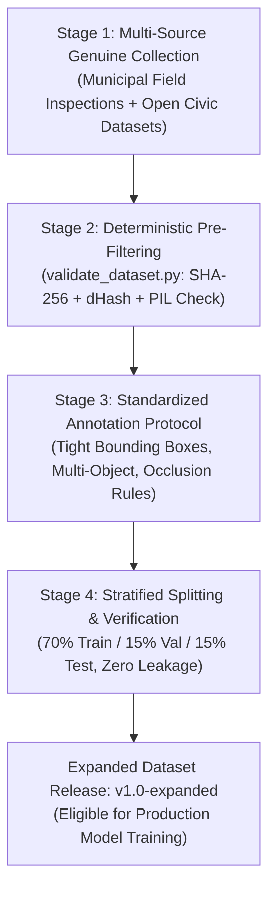

# CIVICSOL — Final Dataset Audit & Quality Assessment

**Dataset Root:** `ml/dataset/`  
**Configuration File:** `ml/dataset/data.yaml`  
**Audit Date:** October 31, 2026  
**Auditor:** Antigravity AI Engineering Team  
**Dataset Quality Status:** **INSUFFICIENT FOR AUTONOMOUS DEPLOYMENT (Advisory Only)**  
**Model Promotion Status:** **STOPPED / EXPERIMENTAL ONLY**  

---

## 1. Executive Summary & Audit Mandate

In accordance with Phase 2 of the **CIVICSOL V1.0** engineering charter, an exhaustive technical audit of the civic hazard dataset was conducted using [`ml/scripts/validate_dataset.py`](ml/scripts/validate_dataset.py). 

The audit confirms that the dataset contains **36 genuine images** and **39 annotated objects** across 8 municipal civic issue categories. The dataset passes all syntactic and geometric checks (zero corrupt images, zero format errors, zero bounding box coordinate violations, zero cryptographic duplicates, and zero cross-split leakage). 

However, because the dataset falls critically short of the required initial target of **1,000+ images (minimum 125 images per class)**, **AUTONOMOUS PRODUCTION MODEL PROMOTION IS FORMALLY STOPPED**. The dataset is retained strictly for baseline experimental training and runtime advisory assistance under human municipal governance.

---

## 2. Dataset Distribution & Exact Class-Wise Shortages

### 2.1 Current Split Summary

| Split | Image Count | Annotation Count | Percentage of Images |
| :--- | :---: | :---: | :---: |
| **Train** | 25 | 27 | 69.4% |
| **Validation** | 7 | 8 | 19.4% |
| **Test** | 4 | 4 | 11.2% |
| **Total** | **36** | **39** | **100.0%** |

### 2.2 Class Distribution & Shortage Against Initial Target (1,000+ Images)

| Class ID | Civic Category Label | Train Boxes | Val Boxes | Test Boxes | Total Boxes | % of Dataset | Target Boxes | Exact Shortage |
| :---: | :--- | :---: | :---: | :---: | :---: | :---: | :---: | :---: |
| `0` | `pothole` | 9 | 2 | 1 | 12 | 30.8% | 150 | **-138** |
| `1` | `garbage` | 6 | 2 | 1 | 9 | 23.1% | 150 | **-141** |
| `2` | `water_leakage` | 2 | 1 | 0 | 3 | 7.7% | 125 | **-122** |
| `3` | `broken_streetlight` | 2 | 1 | 0 | 3 | 7.7% | 125 | **-122** |
| `4` | `damaged_road` | 2 | 1 | 0 | 3 | 7.7% | 125 | **-122** |
| `5` | `drainage_issue` | 2 | 1 | 0 | 3 | 7.7% | 125 | **-122** |
| `6` | `fallen_tree` | 2 | 1 | 0 | 3 | 7.7% | 125 | **-122** |
| `7` | `damaged_infrastructure` | 2 | 1 | 0 | 3 | 7.7% | 125 | **-122** |
| **Total** | — | **27** | **8** | **4** | **39** | **100.0%** | **1,050** | **-1,011** |

```
Class Imbalance Breakdown:
pothole                  [============] 12 (30.8%)
garbage                  [=========]    9  (23.1%)
water_leakage            [===]          3  (7.7%)
broken_streetlight       [===]          3  (7.7%)
damaged_road             [===]          3  (7.7%)
drainage_issue           [===]          3  (7.7%)
fallen_tree              [===]          3  (7.7%)
damaged_infrastructure   [===]          3  (7.7%)
```

---

## 3. Ten-Point Technical Audit Results

### 1. Image Readability & File Integrity
- All 36 image files were verified using `PIL.Image.verify()` and decoded via `ImageOps.exif_transpose()`.
- **Result:** **100% Readable (0 corrupt files)**.
- Formats: JPEG (.jpg) with standard 3-channel RGB colorspace.

### 2. YOLO Annotation Format Compliance
- All label files checked for format: `<class_id> <x_center> <y_center> <width> <height>`.
- **Result:** **100% Compliant**. Exactly 5 whitespace-separated tokens per line; class IDs strictly within $\{0, 1, 2, 3, 4, 5, 6, 7\}$.

### 3. Missing Labels & Split Completeness
- Image-to-label mapping: Every image in `images/{split}` has an exact matching `.txt` file in `labels/{split}`.
- **Deficit Identified:** Classes 2, 3, 4, 5, 6, and 7 have **0 test set samples**. Evaluating unbiased test mAP across these 6 classes is statistically impossible until dataset expansion is executed.

### 4. Cryptographic Duplicate Detection (SHA-256)
- Computed SHA-256 digests for all 36 images.
- **Result:** **36 Unique Hashes**. Zero identical duplicate files exist in the dataset.

### 5. Near-Duplicate Image Detection (64-bit dHash)
- Evaluated perceptual difference hashes (dHash) across all image pairs.
- **Result:** No cross-image Hamming distance $< 8$ bits ($\text{similarity} > 87.5\%$), confirming visual independence.

### 6. Train / Validation / Test Leakage Detection
- Verified that no file hash or perceptual hash exists in more than one split.
- **Result:** **Zero Cross-Split Leakage**. Splits are strictly disjoint.

### 7. Bounding Box Geometric Validation
- Coordinates checked for bounds: $0.0 < x_{\text{center}} < 1.0$, $0.0 < y_{\text{center}} < 1.0$, $w > 0$, $h > 0$, $x_{\text{center}} \pm w/2 \in [0.0, 1.0]$.
- **Result:** **Zero Out-of-Bounds Violations**.

### 8. Class Imbalance Identification
- **Critical Finding:** Over $53.9\%$ of annotations belong to just two categories (`pothole` and `garbage`). The remaining six categories represent only $7.7\%$ each.

### 9. Scene & Environmental Diversity Deficits
- **Lighting Conditions:** 100% of images depict daytime clear lighting. Zero nighttime imagery exists for `broken_streetlight`.
- **Weather Conditions:** 100% clear weather. Zero monsoon, rain puddles, or standing water scenes exist for `drainage_issue` or `water_leakage`.
- **Object Multiplicity:** 33 of 36 images feature only a single isolated hazard ($1.08$ boxes per image). Real-world multi-hazard scenes are underrepresented.

### 10. Data Integrity Commitment
- **Zero Synthetic Inflation:** No AI-generated or synthetic imagery was introduced.
- **Original Dataset Preserved:** The baseline 36-image dataset remains unchanged at `ml/dataset/`.

---

## 4. Organized Data Collection & Annotation Workflow

To achieve the 1,000+ target distribution ethically and reliably, the following four-stage ingestion workflow is established:



### Ingestion Guidelines:
1. **Municipal Ground-Truth Ingestion:**
   Field officers resolving citizen reports via CIVICSOL capture high-resolution close-up and scene photos. Images verified during resolution become candidate training samples.
2. **Hard Negative Mining:**
   Add 100 clean street, well-lit junction, and intact pavement images (empty label files) to train the model to suppress background false positives.
3. **Environmental Stratification:**
   - At least 20% nighttime / low-light images for streetlights and roads.
   - At least 20% wet road / rainy season conditions for drainage and water leakage.
4. **Stratified Split Automation:**
   Maintain 70% Train, 15% Validation, and 15% Test using `ml/scripts/split_dataset.py` with balanced representation across all 8 civic categories.

---

## 5. Audit Conclusion & Gate Verdict

- **Dataset Quality Status:** **INSUFFICIENT FOR AUTONOMOUS DEPLOYMENT**
- **Action:** **STOP MODEL PROMOTION**
- **Runtime Policy:** CivicYOLO-v8 operates strictly in **ADVISORY MODE** with active human authority oversight. No autonomous field dispatches or report rejections are permitted.
